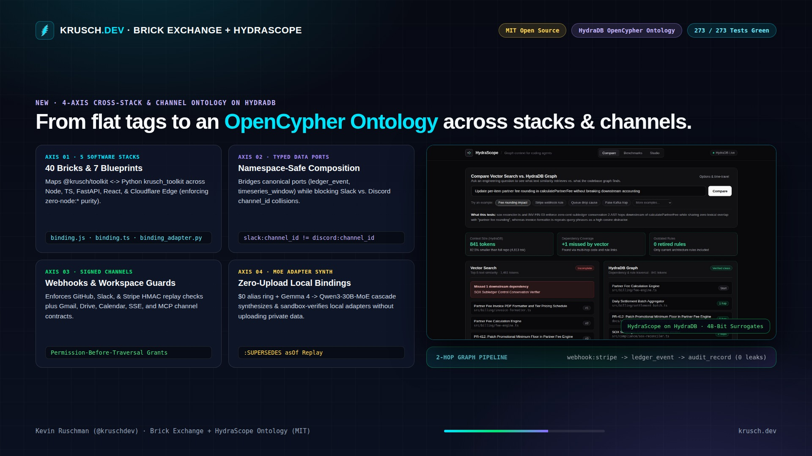
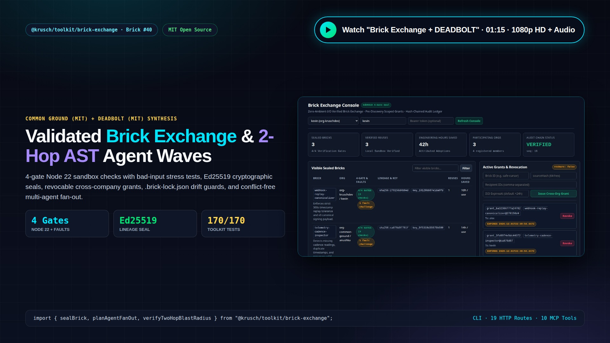
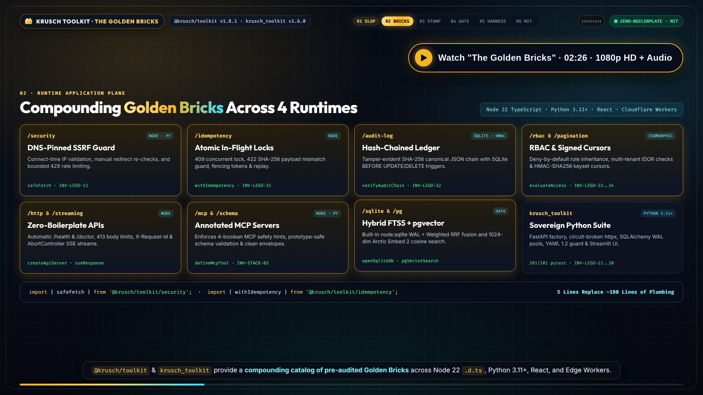

# @krusch/toolkit & `krusch_toolkit`

[](LICENSE)
[](https://nodejs.org)
[](https://www.python.org)
[](#2--core-infrastructure--application-lego-bricks-v181-full-dts-typescript-coverage)

**The Unified Application Runtime Lego Suite (`@krusch/toolkit` v1.8.1 for Node.js / TypeScript / Cloudflare Workers + `krusch_toolkit` v1.6.0 for Python 3.11+).**

`@krusch/toolkit` unifies zero-boilerplate HTTP/SSE/MCP servers, DNS-rebinding-safe SSRF guards, atomic `Idempotency-Key` locks, SHA-256 hash-chained compliance audit ledgers, deny-by-default RBAC & multi-tenant IDOR guards, HMAC-signed keyset cursors, Ed25519-sealed multi-engineer & multi-agent brick exchange with 2-hop AST blast-radius gates, YAML 1.2 & schema validators, `node:sqlite` FTS5/RRF & `pgvector` wrappers, SQLAlchemy WAL/async pools, air-gapped Streamlit shells, multi-tier LLM cascade routing, and research-backed agentic governance bricks under a deterministic `{ ok, tool, summary, data | error }` envelope contract (`INV-LEGO-01`).

> 🔗 **Companion Coding Agent Control Plane**: Pair `@krusch/toolkit` (the *Application Runtime Plane* imported inside the services you build) with **[`krusch-stack`](https://github.com/kruschdev/krusch-stack)** (the *39-tool MCP Coding Agent Control Plane* for Claude Code, Cursor, Windsurf, and Antigravity). `krusch-stack` stamps starter templates backed by `@krusch/toolkit` and audits diffs against `INV-LEGO-01..36` so agents assemble apps from verified bricks rather than hand-rolling boilerplate.

---

## 🎬 Narrated Architecture Walkthroughs (`1080p`)

### 1. *4-Axis Cross-Stack & Channel Ontology on HydraScope + Brick Exchange* (`01:39` · New in `v1.8.1`)

[](https://krusch.dev/assets/video/brick-exchange-ontology-launch.mp4)

> ▶️ **[Stream 1080p HD Ontology Launch Video (`01:39`, with audio)](https://krusch.dev/assets/video/brick-exchange-ontology-launch.mp4)** · **[Paper #30: Ontological Brick Exchange](https://krusch.dev/articles/ontological-brick-exchange-deadbolt-common-ground-hydrascope)** · **[Paper #29: Common Ground & DEADBOLT](https://krusch.dev/articles/mit-open-source-brick-exchange-common-ground-deadbolt)** · **[Local MP4 (`10.1 MiB`)](docs/assets/brick-exchange-ontology-launch.mp4)** · **[Closed Captions (`.srt`)](docs/assets/brick-exchange-ontology-launch.srt)**

### 2. *Validated Brick Exchange & DEADBOLT 2-Hop Agent Waves* (`01:15`)

[](https://krusch.dev/assets/video/brick-exchange-launch.mp4)

> ▶️ **[Stream 1080p HD Launch Video (`01:15`, with audio)](https://krusch.dev/assets/video/brick-exchange-launch.mp4)** · **[Paper #29 on `krusch.dev`](https://krusch.dev/articles/mit-open-source-brick-exchange-common-ground-deadbolt)** · **[Local MP4 (`6.5 MiB`)](docs/assets/brick-exchange-launch.mp4)** · **[Closed Captions (`.srt`)](docs/assets/brick-exchange-launch.srt)**

### 3. *The Golden Bricks* Full Suite Tour (`02:26`)

[](https://krusch.dev/assets/video/krusch-toolkit-golden-bricks.mp4)

> ▶️ **[Stream 1080p HD Walkthrough (`02:26`, with audio)](https://krusch.dev/assets/video/krusch-toolkit-golden-bricks.mp4)** · **[Interactive Player on `krusch.dev`](https://krusch.dev/#video-toolkit)** · **[Local MP4 (`21.7 MiB`)](docs/assets/krusch-toolkit-golden-bricks.mp4)** · **[Closed Captions (`.srt`)](docs/assets/krusch-toolkit-golden-bricks.srt)**

---

## ⚡ Quick Start

### Agent-Assisted Setup

Ask your coding agent (Claude Code, Codex, Cursor, Windsurf, or Antigravity):

```text
Read https://raw.githubusercontent.com/kruschdev/toolkit/main/INSTALL.md and set up toolkit on this machine.
```

### Node.js / TypeScript (`@krusch/toolkit` v1.8.1)

```bash
git clone https://github.com/kruschdev/toolkit.git
cd toolkit
PUPPETEER_SKIP_DOWNLOAD=true npm install
npm test
npm run verify:zero-leaks
```

### Python 3.11+ (`krusch_toolkit` v1.6.0, inside `./python`)

```bash
pip install -e "./python[dev,fastapi,streamlit]"
pytest python/tests -q
```

---

## 🏛️ Architecture & Module Index

### 1. 🤖 Agent Governance & Research Modules

| Module Path | Core Exports | Research Foundation & Capabilities |
|---|---|---|
| `@krusch/toolkit/modular-rsi` | `createModularRsiHarness`, `createSelfImprovementMemory`, `RSI_MODULES`, `DEFAULT_HARNESS_SPECS`, `SIM_TRANSFER_MODES`, `SIM_GUIDANCE_RULES` | **Modular & Continual Recursive Harness Self-Improvement** ([arXiv: 2609.14857](https://arxiv.org/abs/2609.14857) & [arXiv: 2611.18856](https://arxiv.org/abs/2611.18856)): Decomposes harnesses into 5 evolvable modules (`AgentLoop`, `ToolUse`, `ObservationManagement`, `ContextManagement`, `TaskCompletionDetection`) with contrastive failure attribution and problem-grouped Self-Improvement Memory (`SIM`) tracking counterfactual `predicted` vs. `fixed`/`missed` outcomes, alias merges, and cross-dataset/cross-model CRSI transfer advisories. |
| `@krusch/toolkit/kv-cache-manager` | `calculateGvaFootprint`, `createGvaAllocator`, `createKvCacheManager`, `calculateKvCacheMetrics` | **Grouped Value Attention & Persistent Q4 KV Cache** ([arXiv: 2609.13285](https://arxiv.org/abs/2609.13285) & [arXiv: 2603.04428](https://arxiv.org/abs/2603.04428)): 45–47% KV cache footprint reduction via on-demand key projection, >7x Q4-GVA compression, and multi-GPU VRAM headroom scheduling. |
| `@krusch/toolkit/trajectory-guard` | `evaluateMultiAgentResilience`, `createTrajectoryGuard`, `createPigEngine`, `calculateIntelligenceEntropy`, `sanitizeAgentMessage`, `checkGoalDrift` | **Emergence World & PIG Engine** ([arXiv: 2609.17320](https://arxiv.org/abs/2609.17320) & [arXiv: 2606.08162](https://arxiv.org/abs/2606.08162)): Detects error cascades, circular delegation deadlocks, credential leakage, exponential intelligence entropy ($S(t) = S_0 e^{\alpha t}$), and prompt injection propagation. |
| `@krusch/toolkit/skiller` | `routeDiverseSkills`, `createExecutableSkillContract`, `extractSkillFromTrajectory`, `stageSkillForMonorepo` | **Diverse Skill Routing & SKILLER** ([arXiv: 2609.05824](https://arxiv.org/abs/2609.05824) & [arXiv: 2608.10538](https://arxiv.org/abs/2608.10538)): DPP-inspired diversity kernel for selecting orthogonal, non-redundant agent skills; natural-language RL skill synthesis and executable test contracts. |
| `@krusch/toolkit/skill-state` | `createSkillStateManager`, `calculateSkillStateSavings` | **SKILL.state: Bounded Agent State** ([arXiv: 2608.26263](https://arxiv.org/abs/2608.26263)): Maintains explicit mutable state $S_t$, evicts reasoning traces post-validation, and enforces $O(1)$ prompt size bounds (up to 16x token reduction). |
| `@krusch/toolkit/second-thought` | `createSecondThoughtEngine` | **Second Thought Parallel Auxiliary Reasoning** ([arXiv: 2608.13667](https://arxiv.org/abs/2608.13667)): Pre-synthesizes speculative success and error-recovery branches concurrently during tool I/O latency windows. |
| `@krusch/toolkit/dhd-deliberation` | `extractTrajectoryValue`, `evaluateDHDConsensus` | **Diverse Hypothesis Deliberation & Trajectory Value** ([arXiv: 2608.14375](https://arxiv.org/abs/2608.14375) & [arXiv: 2608.25937](https://arxiv.org/abs/2608.25937)): Extracts structural invariants and failure boundaries from failed candidate runs ("Wrong but Useful"). |
| `@krusch/toolkit/prune` | `shouldActivateMemory`, `createKnowledgeBoundaryRouter`, `prunePreRetrieval`, `prunePostRetrieval`, `prunePreSynthesis`, `createContextPruner` | **Knowledge Boundary Routing & Context Pruning** ([arXiv: 2608.23982](https://arxiv.org/abs/2608.23982) & [arXiv: 2608.08389](https://arxiv.org/abs/2608.08389)): Conditional memory retrieval gating to bypass memory on self-contained math/syntax queries; 3-stage marginal value context pruning. |
| `@krusch/toolkit/spec-verifier` | `createSpecAuditRunner`, `runAuditPass`, `runRefereeAuditPass`, `runThreeFamilyRefereeAudit`, `evaluateRefereeConsensus`, `checkConvergence`, `synthesizeExecutableContract`, `evaluateDualTrackRefinement` | **Spec-First Verification & 3-Family Referee Consensus** ([arXiv: 2608.12440](https://arxiv.org/abs/2608.12440), [arXiv: 2608.03744](https://arxiv.org/abs/2608.03744), [arXiv: 2608.16742](https://arxiv.org/abs/2608.16742)): Dual-zero-defect convergence gate, concurrent 3-family referee re-derivation with pre-findings `"invariantChecks"`, and executable test contracts. |
| `@krusch/toolkit/memory-invalidation` | `ArtifactVerificationGraph`, `anchorVerificationClaim`, `checkArtifactDrift`, `computeArtifactHash`, `MemoryInvalidationEngine`, `filterActiveMemories` | **EA-Graph & Temporal Fact Invalidation** ([arXiv: 2608.04278](https://arxiv.org/abs/2608.04278) & [arXiv: 2608.13606](https://arxiv.org/abs/2608.13606)): Anchors verification claims to source file SHA-256 content hashes; auto-invalidates claims on upstream code drift. |
| `@krusch/toolkit/harness-engineering` | `HARNESS_SUBSYSTEMS`, `createFrozenPolicyFloor`, `deobfuscateShellCommand`, `validatePolicyRuleExamples`, `delimitUntrustedContent`, `evaluateTruncationPoisoningGuard`, `evaluateVerifyOnStopGuard`, `createDeferredToolBridge`, `normalizePromptCachePrefix` | **7-Subsystem Autonomous Harness Engineering** ([arXiv: 2609.00006](https://arxiv.org/abs/2609.00006)): Import-frozen policy floors (`autoApprove`/`yolo`-proof), shell deobfuscation, load-time rule self-tests, `<UNTRUSTED_CONTENT>` taint tags, `MAX_TOKENS` truncation-poisoning & verify-on-stop loop guards, Okapi BM25 deferred tool discovery, and SHA-256 KV-cache prefix normalization. |
| `@krusch/toolkit/grounded-harness` | `SCALE_TIERS`, `resolveScaleProfile`, `buildScaleAwareDirective`, `buildSafeGeminiToolConfig`, `normalizeCodeSnippetForHash`, `inspectOutputDefects`, `detectDatasetSchemaHazards`, `formatTimeoutWithPartialStdout`, `runAsyncWithPartialStdout`, `createToolBudgetGate`, `createDeltaContextTracker` | **Turn-0 Grounded & Scale-Aware Harness Primitives** (`INV-GH-01..10`): Monotonic `SMALL_MODEL` / `MID_MODEL` / `FRONTIER_REASONING` policy, CSV `"NA"` & JSON `null`/`[]` wildcard hazard detection, Gemini tool-less `mode: "NONE"` guard, quote-safe spin-loop call hashing (`maxReadStreak = 0`), zero-turn defect-only output gate, and partial-stdout timeout recovery. |
| `@krusch/toolkit/raw-rag` | `createRawRagIndex`, `chunkConversationWindows`, `rerankCandidateWindows`, `assembleReaderEvidence`, `auditRagBaselineConfig`, `normalizeAppendOnlyWriteOp`, `evaluateCoverageAndUtilization`, `evaluateConditionalPathRetention` | **Source-Preserving Episodic RAG & Append-Only Memory** ([arXiv: 2610.30755](https://arxiv.org/abs/2610.30755)): Zero-LLM ingestion (`256`-tok / `32`-overlap turn-linked windows), `Top-128` dense + `Top-15` cross-encoder rerank, `5,000`-token graceful turn-expansion fallback, `ADD/NONE` non-destructive write policy, and $\widehat{C}_s/\widehat{U}_s$ & $P(\text{path}\mid\text{result})$ diagnostics. |
| `@krusch/toolkit/vld-scaling` | `VLD_PATTERNS`, `compileVldSchedule`, `calculateKnowledgeCapacityEntropy`, `verifyVldCapacityInvariance`, `estimateReasoningDepth`, `detectVldFixedPoint`, `createVldScalingEngine` | **Virtual Logical Depth (VLD) Scaling Laws** ([arXiv: 2506.18233v3](https://arxiv.org/abs/2506.18233v3)): 4th scaling dimension (`Sequence`, `Cycle`, `Inverse Cycle`, and `Late-Layer Cycle` weight reuse), $\Delta H = H_1 - H_2$ knowledge entropy measurement ($\approx 2\text{ bits/param}$), `iGSM` operational depth estimation, and fixed-point halting. |

---

### 2. 🧰 Core Infrastructure & Application Lego Bricks (`v1.8.1`, Full `.d.ts` TypeScript Coverage)

Every subpath export ships strict `.d.ts` declarations (`./types/*.d.ts`) compatible with `moduleResolution: "NodeNext"` and zero-build Node 22 TypeScript (`node --experimental-strip-types`).

| Module Path | Core Exports | Description |
|---|---|---|
| `@krusch/toolkit/http` | `createApiServer`, `createExpressBricks`, `readBoundedJsonBody`, `okEnvelope`, `errorEnvelope`, `asyncHandler`, `attachGracefulShutdown` | Zero-boilerplate HTTP/Express server factory with `/health` & `/doctor`, CORS, `413` TCP-RST-safe body limits, `X-Request-Id` timing, and graceful shutdown. |
| `@krusch/toolkit/streaming` | `sseResponse`, `streamChat` | `AbortController`-safe Server-Sent Events (SSE) with `X-Accel-Buffering: no`, `: ping` heartbeats, and native Ollama/LLM stream piping. |
| `@krusch/toolkit/mcp` | `defineMcpTool`, `createMcpServer`, `okMcpResult`, `errorMcpResult`, `validateToolArgs` | Compliant Stdio MCP server brick enforcing `INV-STACK-03` 4-boolean annotations, schema arg validation, and universal JSON envelopes. |
| `@krusch/toolkit/pg` | `createPgPool`, `runSqlMigrations`, `pgVectorSearch`, `buildPgConnectionString`, `assertSafePgIdentifier` | Retry-guarded PostgreSQL pool, transactional `schema_migrations` runner, and 1024-dim `snowflake-arctic-embed2` `<=>` cosine search. |
| `@krusch/toolkit/sqlite` | `openSqliteDb`, `escapeFts5Query`, `fuseRrfResults`, `DatabaseSync`, `isSqliteCorruptionError` | Zero-native-addon `node:sqlite` WAL factory (`BEGIN IMMEDIATE` + nested `SAVEPOINT`), deterministic FTS5 query escaper, and Weighted Reciprocal Rank Fusion (`INV-LEGO-12`). |
| `@krusch/toolkit/security` | `isPrivateOrReservedIp`, `validateOutboundUrl`, `safeFetch`, `createRateLimiter` | DNS-rebinding-safe outbound SSRF guard (connect-time `undici` IP check + manual redirect re-validation) and bounded memory-safe `429` rate limiter (`INV-LEGO-13`). |
| `@krusch/toolkit/idempotency` | `createIdempotencyStore`, `withIdempotency`, `createIdempotencyMiddleware`, `computePayloadFingerprint`, `normalizeIdempotencyKey` | Atomic `Idempotency-Key` in-flight lock (`409`), SHA-256 payload-mismatch guard (`422`), fencing tokens, and tenant-scoped replay middleware (`INV-LEGO-31`). |
| `@krusch/toolkit/audit-log` | `createAuditLog`, `verifyAuditChain`, `computeAuditEntryHash`, `canonicalizeAuditPayload`, `GENESIS_AUDIT_HASH` | Tamper-evident SHA-256 / HMAC hash-chained compliance ledger with canonical JSON serialization and SQLite `BEFORE UPDATE/DELETE` immutability triggers (`INV-LEGO-32`). |
| `@krusch/toolkit/rbac` | `createRbacPolicy`, `evaluateAccess`, `assertTenantOwnership`, `createRbacGuard`, `matchPermissionPattern` | Zero-`node:*` deny-by-default role inheritance & scoped permission evaluator with explicit-deny precedence and OWASP A01 multi-tenant IDOR guards (`INV-LEGO-33`). |
| `@krusch/toolkit/pagination` | `clampPageLimit`, `encodeCursor`, `decodeCursor`, `buildKeysetPage`, `paginateItems` | Constant-time HMAC-SHA256 tamper-signed base64url keyset cursor encoder/decoder with scope/TTL binding and bounded page-limit clamps (`INV-LEGO-34`). |
| `@krusch/toolkit/brick-exchange` | `sealBrick`, `verifyBrickBundle`, `runBrickRepairLoop`, `createBrickExchangeStore`, `tryBrickLocally`, `adoptBrickIntoRepo`, `auditRepoBrickLocks`, `analyzeBrickBlastRadius`, `planAgentFanOut`, `verifyTwoHopBlastRadius`, `checkOntologyCompatibility`, `compileBrickOntologyGraph`, `traverseBrickOntology`, `synthesizeBrickBinding`, `createBrickExchangeServer`, `createBrickExchangeMcpServer` | Cryptographically attested multi-engineer & multi-agent Validated Brick Exchange: Node 22 `--permission` sandbox + mandatory fault challenges, Ed25519 seals, scoped grants, local `binding` synthesis & re-verification, `.brick-lock.json` drift checks, 4-axis cross-stack HydraScope ontology, and Deadbolt 2-hop AST blast-radius & fan-out wave planning (`INV-LEGO-35..36`). |
| `@krusch/toolkit/schema` | `s`, `toJsonSchema`, `validateSchema`, `validatePayload`, `createSchemaMiddleware` | Zero-`node:*` composable schema builder, Zod/JSON-Schema adapter, MCP `inputSchema` compiler, and prototype-safe validation middleware (`INV-LEGO-17`). |
| `@krusch/toolkit/yaml` | `DEFAULT_YAML_LIMITS`, `parseSafeYaml`, `stringifySafeYaml`, `validateYamlConfig`, `loadSafeYamlPack` | Zero-dependency, zero-`node:*` isomorphic YAML 1.2 Core parser/serializer with alias-bomb & tag guards, schema validation, and SHA-256 pack loading (`INV-LEGO-23`). |
| `@krusch/toolkit/upload` | `sanitizeUploadFilename`, `sniffMimeMagic`, `verifyUploadMime`, `parseBoundedMultipart` | Stream-draining $O(N)$ `multipart/form-data` parser with pre-buffer byte ceilings, path-traversal filename sanitizer, and magic-byte MIME guard (`INV-LEGO-18`). |
| `@krusch/toolkit/cascade` | `DEFAULT_FLEET_CASCADE_TIERS`, `createTierCircuitBreaker`, `selectCascadeTier`, `probeBurstEndpoint`, `executeWithCascadeFallback` | Zero-`node:*` `<25µs` L1–L3 cascade tier selector, single-flight `HALF_OPEN` circuit breaker, GPU burst probe, and `AbortController` fallback runner (`INV-LEGO-19`). |
| `@krusch/toolkit/audio` | `encodeWavPcm16`, `parseWavHeader`, `transcribeWhisperAudio`, `synthesizeSpeechAudio` | Zero-`node:*` RIFF/WAVE PCM16 encoder/parser (`JUNK`/`LIST` chunk-tolerant) plus `AbortController`-bounded Whisper STT and streaming TTS clients (`INV-LEGO-20`). |
| `@krusch/toolkit/lego-scout` | `scoutHomelabLegoCandidates`, `CANDIDATE_PATTERN_SIGNATURES`, `formatPortableProjectPath` | Cross-repository boilerplate adoption auditor and `>= 3` Rule-of-3 Anti-Bloat brick candidate scout (`INV-LEGO-15..16`). |
| `@krusch/toolkit/react` | `cn`, `STYLES`, `useAesthetics`, `fetchApiJson`, `useApiQuery`, `useSSEStream`, `AppShell`, `StatusPill`, `MetricCard`, `StreamingChatPanel`, `ErrorBoundary` | Headless-safe React design tokens, `AbortController`-managed fetch/SSE hooks, and drop-in pure `createElement` dashboard shells. |
| `@krusch/toolkit/edge` | `createEdgeRouter`, `edgeSseResponse`, `createEdgeKvJsonStore`, `readBoundedEdgeJson`, `edgeCorsHeaders`, `edgeOkResponse`, `edgeErrorResponse` | Zero-`node:*` Web-Standards router, `413` body guard, SSE stream, and KV store for Cloudflare Workers and edge runtimes (`INV-LEGO-08`). |
| `@krusch/toolkit/webhooks` | `constantTimeEqual`, `signWebhookHmac`, `verifySlackSignature`, `verifyGithubSignature`, `verifyStripeSignature`, `verifyBearerToken` | Constant-time HMAC-SHA256 webhook signature verifiers (Slack, GitHub, Stripe) with replay protection and SHA-256 Bearer auth (`INV-LEGO-09`). |
| `@krusch/toolkit/cli` | `withSingleInstanceLock`, `attachDaemonSignals`, `appendJsonlRecord`, `defineCli` | Atomic `wx` PID/nonce single-instance cron lockfile guard, daemon signal teardown, NDJSON telemetry appender, and `--json` CLI builder (`INV-LEGO-10`). |
| `@krusch/toolkit/catalog` | `RUNTIME_BRICKS`, `PROJECT_ARCHETYPES`, `listLegoBricks`, `listArchetypes`, `auditBoilerplateText`, `scoreLegoBrickCoverage` | Zero-`node:*` machine-readable catalog of 40 runtime bricks, 7 zero-LLM project blueprints, and 16 `<1ms` Slop-Breaker detectors (`krusch-lego` CLI, `INV-LEGO-35`). |
| `@krusch/toolkit/scaffold` | `scaffoldProject` | Deterministic `<50ms` zero-LLM blueprint stamper (`node-api-sqlite`, `node-ts-service`, `node-rag-pgvector`, `mcp-stdio-server`, `fullstack-react-vite`, `python-fastapi-service`, `cloudflare-worker`). |
| `@krusch/toolkit/embeddings` | `embed`, `embedBatch`, `embedChunkedCentroid`, `createEmbeddings`, `formatEmbeddingInput`, `calibrateQuerySimilarity` | Asymmetric query/document 1024-dim `snowflake-arctic-embed2` embedding client with batch `/api/embed` fallback and L2 centroid pooling. |
| `@krusch/toolkit/llm` | `chat`, `chatJson`, `resolveModelConfig`, `resolveGeminiToolConfig`, `isGemini4Model`, `normalizeThinkingLevel`, `resolveMaxOutputTokens`, `buildGeminiPayload`, `extractGeminiTextParts` | Multi-provider unified LLM client (`gemini-4-argon` & `gemini-3.8-flash` with multi-hop `CONTINUATION`, `thinkingLevel`, and automatic tool-less `functionCallingConfig: { mode: 'NONE' }`, OpenRouter, xAI Grok, Ollama, and optional [`krusch-cascade-router`](https://github.com/kruschdev/krusch-cascade-router)). |
| `@krusch/toolkit/vision` | `callGeminiMedia`, `callGeminiMediaJson` | Multimodal `gemini-4-argon` vision/audio/PDF client supporting `mediaItems`, `thinkingLevel`, `65,536` `maxOutputTokens`, and multi-hop `CONTINUATION`. |
| `@krusch/toolkit/decide` | `decide`, `decideBatch`, `calibrateChoiceLogprobs`, `createSystem1Decider` | Single-token logprob System 1 decision router (`max_tokens: 1`, `temperature: 0`, `logprobs: true`) with LRU cache and deterministic offline CI fallback. |
| `@krusch/toolkit/db` | `initDb`, `getDb`, `query`, `queryOne`, `run`, `transaction`, `isSqliteCorruptionError` | Singleton SQLite WAL wrapper with compound-fault crash recovery (`INV-REC-01..05`). |
| `@krusch/toolkit/config` | `loadProjectConfig`, `createConfig`, `envOr`, `envInt`, `envBool` | Layered configuration loader: Defaults → `config.json` → `.env` → System Environment. |
| `@krusch/toolkit/auth` | `createAuth` | Factory-based JWT authentication middleware and `httpOnly` cookie management. |
| `@krusch/toolkit/dbos` | `createDbosClient`, `DbosClient` | Stateful workflow queue client, blocking polls, and worker queue healing. |
| `@krusch/toolkit/log` | `setupLogging` | Structured rotating JSON logger with standard metadata. |
| `@krusch/toolkit/browser` | `launchBrowser`, `scrapeHtml`, `captureScreenshot`, `runInteractiveSession`, `captureResponsiveBreakpoints`, `auditPageWithArgon` | Stealth Puppeteer browser automation, `375/768/1440px` breakpoint capture, console/network telemetry, and Gemini 4 Argon visual UI auditing. |
| `@krusch/toolkit/polygres` | `createPolygresClient`, `PolygresClient` | Dual-engine PostgreSQL client: local `pg.Pool` wire connection + Polygres Cloud 0.5.0 Runtime REST API. |
| `@krusch/toolkit/imagen` | `createImageGenerator` | Gemini native image generation for thumbnails, slides, and promotional assets. |
| `@krusch/toolkit/scheduler` | `createScheduler` | Safe `node-cron` task scheduler with integrated error trapping. |

---

### 3. 🐍 Python Lego Suite (`krusch_toolkit` v1.6.0, `./python`)

All Python Lego bricks import cleanly in bare Python 3.11+ stdlib (lazy-loading optional `fastapi`, `httpx`, `streamlit`, `sqlalchemy`, or `pyyaml` only when invoked).

| Python Module | Core Exports | Description |
|---|---|---|
| `krusch_toolkit.fastapi_app` | `create_fastapi_app`, `ok_envelope`, `error_envelope`, `sse_event_response`, `format_sse_frame` | Zero-boilerplate FastAPI factory with `/health` & `/doctor`, CORS credentials guard, `X-Request-ID`, SSE framing, and brownfield compatibility switches (`INV-LEGO-25`). |
| `krusch_toolkit.http_client` | `request_json`, `async_request_json`, `HttpCircuitBreaker`, `create_http_circuit_breaker`, `build_resilient_headers` | Connect-time DNS-pinned SSRF-safe sync/async HTTP client with single-flight `HALF_OPEN` circuit breaker, bounded stream caps, and cross-origin auth stripping (`INV-LEGO-21`). |
| `krusch_toolkit.streamlit_ui` | `render_sovereign_rag_shell`, `render_citation_badges`, `init_rag_session_state`, `append_rag_turn`, `build_airgapped_theme_css` | Air-gapped, XSS-hardened Streamlit RAG shell with offline system fonts and safe citation badge rendering (`INV-LEGO-22`). |
| `krusch_toolkit.yaml_loader` | `parse_safe_yaml`, `dump_safe_yaml`, `validate_yaml_config`, `load_safe_yaml_pack`, `DEFAULT_YAML_LIMITS` | `_SovereignSafeLoader` YAML 1.2 Core loader blocking custom `!` tags, Norway boolean coercion, prototype pollution, path traversal, and Billion-Laughs alias bombs (`INV-LEGO-23`). |
| `krusch_toolkit.db_async` | `create_managed_engine`, `create_managed_async_engine`, `session_scope`, `async_session_scope`, `redact_database_url`, `check_engine_health` | SQLAlchemy sync/async pool factory with automatic SQLite WAL pragmas, credential-redacted errors, and transactional scopes (`INV-LEGO-24`). |
| `krusch_toolkit.mcp` | `define_mcp_tool`, `ok_mcp_result`, `error_mcp_result`, `validate_tool_args`, `dispatch_mcp_tool` | Python MCP tool definition & dispatch enforcing `INV-STACK-03` 4-boolean annotations (`INV-LEGO-14`). |
| `krusch_toolkit.pg` & `.security` | `build_pg_connection_string`, `run_sql_migrations`, `pg_vector_search`, `is_private_or_reserved_ip`, `validate_outbound_url`, `verify_webhook_hmac`, `verify_bearer_token` | SQLi-guarded `pgvector` search, transactional migrations, IPv4/IPv6 SSRF validation, and constant-time HMAC/Bearer verification (`INV-LEGO-14`). |
| `krusch_toolkit.schema` & `.upload` | `validate_json_schema`, `validate_payload`, `sanitize_upload_filename`, `sniff_mime_magic`, `verify_upload_mime`, `read_bounded_upload` | Pydantic v2 / JSON Schema payload validator and streaming byte-bounded upload + MIME magic verifier (`INV-LEGO-20`). |
| `krusch_toolkit.embeddings` & `.raw_rag` | `embed`, `embed_batch`, `embed_chunked_centroid`, `create_raw_rag_index`, `chunk_conversation_windows` | Python 1024-dim `snowflake-arctic-embed2` client and 256/32-token source-preserving episodic RAG index. |

---

### 4. 🏗️ Physical AI & Spatial Intelligence

| Module Path | Core Exports | Description |
|---|---|---|
| `@krusch/toolkit/spatial-kg` | `SpatialKnowledgeGraph`, `SpatialNode`, `InfrastructureEdge` | Hierarchical 3D spatial knowledge graph for digital twins and building systems. |
| `@krusch/toolkit/evqa-grounding` | `EvidenceGroundingEngine`, `VideoEvidenceSegment` | Evidence-backed video QA grounding for site walkthroughs. |
| `@krusch/toolkit/hydra-action-flow` | `HydraWorldModelEngine`, `ActionFlowVector`, `createHydraEngine` | Forward spatial transition modeling and demonstration-to-policy inverse control. |
| `@krusch/toolkit/sparse-pr` | `SparsePROptimizer`, `VideoTokenBlock`, `createSparsePROptimizer` | Block-sparse video attention and residual reconstruction. |
| `@krusch/toolkit/physcap-policy` | `PhysicsConstraintEvaluator`, `PhysCaPPolicyGenerator` | Physics-informed spatial grounding (plumbing slope, joist boring, electrical ampacity). |
| `@krusch/toolkit/matterport-importer`| `MatterportImporter`, `createMatterportImporter` | Ingestion and digital twin fusion of Matterport spatial sweep stations. |

---

## 🛠️ Zero-LLM Blueprint, Brick Exchange & Blast-Radius CLI (`krusch-lego`)

```bash
# List all 40 runtime Lego bricks + 7 starter blueprints (node | python | react | edge)
node ./bin/krusch-lego.js list

# Inspect exact import & usage snippet for a brick
node ./bin/krusch-lego.js inspect brick-exchange

# Stamp a runnable Node 22 TypeScript or Cloudflare Worker skeleton in <50ms with 0 LLM tokens
node ./bin/krusch-lego.js stamp node-ts-service ./my-ts-api --port 3050
node ./bin/krusch-lego.js stamp cloudflare-worker ./my-worker

# Seal, verify, locally test with your own binding, and vendor a shared brick (.brick-lock.json)
node ./bin/krusch-lego.js keygen --out ./.keys
node ./bin/krusch-lego.js seal ./brick-spec.json --key ./.keys/brick-signing.key.pem --out ./telemetry.brick.json
node ./bin/krusch-lego.js try ./telemetry.brick.json --input ./my-sample.json --binding ./my-binding.json
node ./bin/krusch-lego.js adopt ./telemetry.brick.json ./my-service --by maya

# Map 2-hop AST blast radius or sequence conflict-free multi-agent fan-out waves
node ./bin/krusch-lego.js blast-radius bricks/fee-engine/index.js ./my-service
node ./bin/krusch-lego.js fanout ./work-orders.json ./my-service

# Launch the self-hosted Brick Exchange Hub + Reuse Console (or stdio MCP server for coding agents)
node ./bin/krusch-lego.js hub --db ./data/exchange.db --port 4318
node ./bin/krusch-lego.js mcp --db ./data/exchange.db

# Audit a project directory for boilerplate slop AND .brick-lock.json SHA-256/Ed25519 drift
node ./bin/krusch-lego.js audit ./my-service
node ./bin/krusch-lego.js scout ./projects --portable --json
```

---

## 🤝 Multi-Engineer & Multi-Agent Validated Brick Exchange (`@krusch/toolkit/brick-exchange`)

> 🎬 **[Watch the 01:39 Ontology Launch Video (`1080p` HD)](https://krusch.dev/assets/video/brick-exchange-ontology-launch.mp4)** · **[Read Paper #30: Ontological Brick Exchange on HydraScope](https://krusch.dev/articles/ontological-brick-exchange-deadbolt-common-ground-hydrascope)** · **[Read Paper #29: Fusing Common Ground & DEADBOLT Under MIT](https://krusch.dev/articles/mit-open-source-brick-exchange-common-ground-deadbolt)**

Engineering teams and parallel coding-agent swarms hit three recurring failure modes when moving fast:
1. **Unverified Cross-Team Copy-Paste**: Teams rebuild or copy subtle parsers, fee allocators, and webhook verifiers without proving fault-handling parity on their own data.
2. **The 0-Hop Blind Spot**: Unit tests pass on an edited module at `hop 0`, while breaking an invariant consumer **2 hops away** in the AST call graph (`bricks/fee-engine/index.js -> src/settlement-service.js -> src/sox-reconciler.js`).
3. **Silent Parallel Fan-Out Collisions**: Two engineers or subagents edit different `targetFiles` whose **2-hop blast-radius cones** overlap, creating silent integration bugs on merge.

`@krusch/toolkit/brick-exchange` combines multi-organization validated code sharing (extending MIT-licensed concepts from [`0xANUSHKA/common-ground-8090`](https://github.com/0xANUSHKA/common-ground-8090)) with **Deadbolt** 2-hop AST governance:

- **4-Gate Hermetic Sealing (`sealBrick`, `runBrickRepairLoop`)**: Scans for zero ambient I/O & zero secret/IP leaks, strips TypeScript natively, runs inside a Node 22 `--permission` subprocess + locked `vm` context (`32 MB` RAM, `800 ms` deadline), requires **mandatory adversarial fault-injection challenges**, and signs canonical lineage with **Ed25519** chained into `@krusch/toolkit/audit-log`.
- **Immutable Core + Local `binding` Adapter (`tryBrickLocally`, `adoptBrickIntoRepo`)**: Recipients run the byte-exact sealed brick locally against their own schema/port `binding` with zero data uploaded, vendor `bricks/<id>/index.js` + `.brick-lock.json`, and catch any unauthorized 1-byte mutation via `krusch-lego audit`.
- **Tiered Governance & Optional HydraDB v2 Discovery (`createBrickExchangeStore`)**: Frictionless `team` commons inside one team; Common Ground scoped, expiring, revocable, non-reshareable `Grant`s across peer organizations evaluated *before* discovery, with optional permission-scoped `@krusch/toolkit/hydradb` graph relevance and `/feedback` on adoption.
- **Deadbolt 2-Hop AST Blast Radius & Fan-Out Waves (`analyzeBrickBlastRadius`, `planAgentFanOut`, `verifyTwoHopBlastRadius`)**: Maps `hop0 -> hop1 -> hop2` caller paths, sequences colliding subagents into conflict-free waves while reserving choke points (`server.js`, `index.js`, `package.json`), blocks sneaky Policy Floor workarounds on protected verifiers, and runs 2-hop downstream reconciliation inside a `--permission` jail.
- **4-Axis Cross-Stack, Channel & MoE Ontology Backed by HydraScope (`ontology.js`, `INV-LEGO-36`)**: Maps `@krusch/toolkit` (`40` bricks, `7` blueprints) and Python `krusch_toolkit` (`CROSS_STACK_BRICK_EQUIVALENTS`) across `node-esm`, `typescript-node`, `python-fastapi`, `react-vite`, and `cloudflare-edge` (enforcing zero-`node:*` Web-Standard purity on Edge/React); wires schema-typed `ONTOLOGY_DATA_PORTS` + `@krusch/toolkit/tool-graph` `CANONICAL_SHARED_TYPES` (isolating opaque `slack:channel_id` vs `discord:channel_id` ports), `ONTOLOGY_CHANNELS` (`@krusch/toolkit/webhooks` HMAC guards + `g-krusch` Workspace verbs), and `@krusch/toolkit/cascade` MoE profiles (`$0` Tier-0 alias mapper -> `L1_FAST` `gemma4:e4b` -> `L2_HEAVY_MOE` `qwen3-coder-30b-moe:latest`); compiles 48-bit `surrogateId` OpenCypher graphs with `:SUPERSEDES` `asOf` replay and permission-before-traversal 2-hop composition (`planCrossStackComposition`); and synthesizes sandbox-verified `binding.js` / `binding.ts` / `binding_adapter.py` adapters (`synthesizeBrickBinding`, `krusch-lego ontology inspect|check|compose|bind`) with zero private sample upload.

```javascript
import { sealBrick, planAgentFanOut, verifyTwoHopBlastRadius } from '@krusch/toolkit/brick-exchange';
import { s } from '@krusch/toolkit/schema';

// 1. Seal a zero-ambient-I/O brick only after positive + fault-injection gates pass
const sealed = await sealBrick({
    blueprint: {
        id: 'telemetry-completeness',
        exportName: 'inspectSeries',
        inputSchema: s.array(s.object({ ts: s.number(), val: s.any() })),
        outputSchema: s.object({ rows: s.number(), missingCount: s.number() })
    },
    source: `export function inspectSeries(rows, binding = {}) {
        const body = binding.skipUnitsRow ? rows.slice(1) : rows;
        return { rows: body.length, missingCount: body.filter(r => r.val === null).length };
    }`,
    positiveChecks: [{ name: 'clean window', input: [{ ts: 0, val: 'units' }, { ts: 60, val: 4.2 }], binding: { skipUnitsRow: true }, expectedOutput: { rows: 1, missingCount: 0 } }],
    faultChecks: [{ name: 'catches injected null gap', input: [{ ts: 60, val: null }], expectedOutput: { rows: 1, missingCount: 1 } }]
});

// 2. Sequence parallel subagents or engineers using 2-hop AST blast-radius cones
const fanout = planAgentFanOut({
    repoDir: './billing-service',
    tasks: [
        { id: 'AGENT-A', targetFiles: ['bricks/fee-engine/index.js'] },
        { id: 'AGENT-B', targetFiles: ['src/settlement-service.js'] }, // sequenced to Wave 2 (inside AGENT-A 2-hop cone)
        { id: 'AGENT-C', targetFiles: ['src/webhook-hmac.js'] }        // runs in Wave 1 in parallel with AGENT-A
    ],
    protectedFiles: ['src/sox-reconciler.js']
});

// 3. Verify candidate edits against subagent lease, Policy Floor, AST exports, and 2-hop invariants
const gate = await verifyTwoHopBlastRadius({
    repoDir: './billing-service',
    candidateEdits: { 'bricks/fee-engine/index.js': updatedBrickSource },
    lease: fanout.data.agentLeases[0],
    protectedFiles: ['src/sox-reconciler.js'],
    invariantEntryFile: 'tests/sox-batch-reconcile.test.js'
});
```

---

## 💻 Code Examples

### 1. Grouped Value Attention (GVA) & GPU VRAM Scheduling
```javascript
import { createGvaAllocator } from '@krusch/toolkit/kv-cache-manager';

const allocator = createGvaAllocator({
    node: 'gpu-worker-1',
    totalVramBytes: 24 * 1024 * 1024 * 1024,
    reservedModelVramBytes: 14 * 1024 * 1024 * 1024
});

const recommendation = allocator.recommendStrategy({
    contextTokens: 32768,
    batchSize: 2
});

console.log(recommendation.strategy); // 'GVA_COMPRESSION' or 'Q4_GVA_PERSISTENCE'
console.log(`Footprint savings: ${recommendation.metrics.gvaSavingsPercent}%`);
```

### 2. Emergence World Multi-Agent Resilience Gate
```javascript
import { evaluateMultiAgentResilience } from '@krusch/toolkit/trajectory-guard';

const result = evaluateMultiAgentResilience(agentHandoffs, { maxCascadeDepth: 2 });

if (!result.resilient) {
    console.warn(`Resilience Gate Alert: ${result.verdict}`, result.issues);
}
```

---

## 🧪 Testing & Zero-Leak Verification

```bash
# 1. Run deterministic Zero-Leak security & sanitization gate
npm run verify:zero-leaks

# 2. Run all Node.js / TypeScript unit & integration suites (183/183 passing)
npm test

# 3. Run all Python unit & integration suites (201/201 passing)
pytest python/tests -q
```

---

## 📜 License

[MIT](LICENSE) © `kruschdev`

### Third-Party Open-Source Attribution

Multi-organization permission evaluation, mutual peer allowlisting, sender muting, exporter revocation enforcement, and scoped non-reshareable federated grant lineage concepts in `@krusch/toolkit/brick-exchange` are adapted from [`0xANUSHKA/common-ground-8090`](https://github.com/0xANUSHKA/common-ground-8090) (`MIT License`, Copyright (c) 2026 Anushka Jogalekar and Common Ground contributors).
